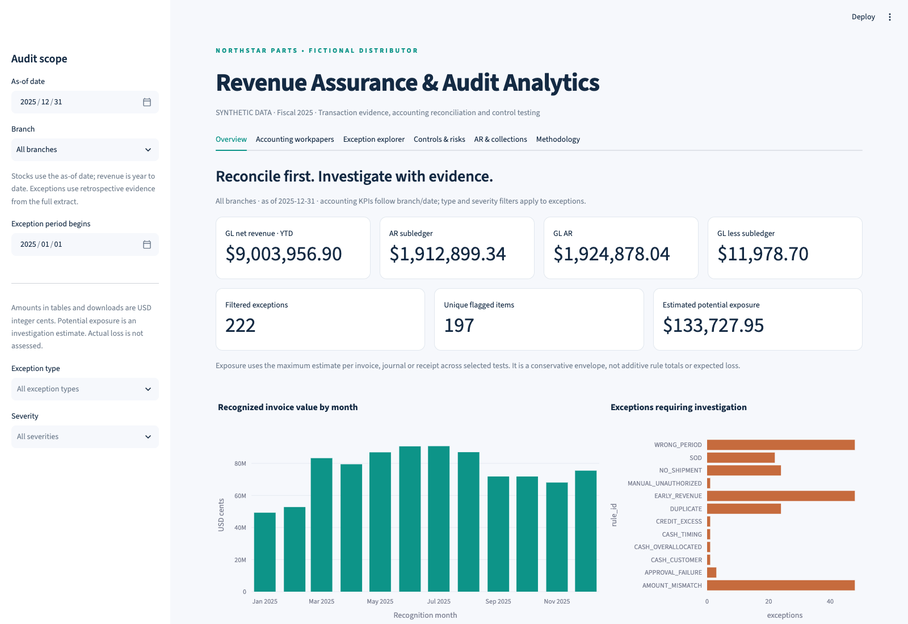
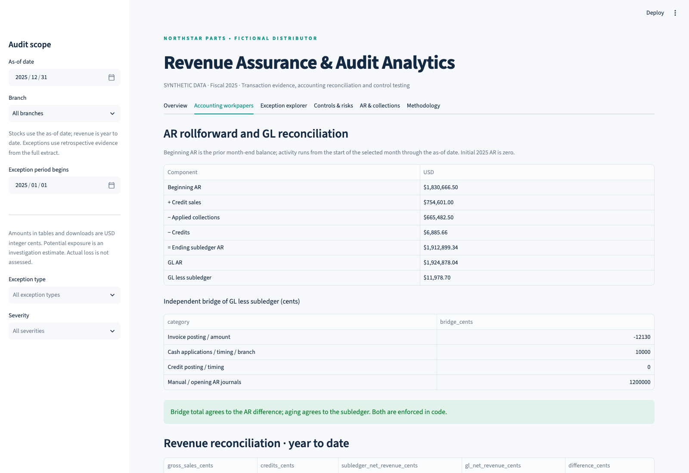

# Revenue Assurance & Audit Analytics

**An accounting and controls investigation system for a fictional automotive parts distributor. All company data is synthetic.**

Built as an Accounting Information Systems / Business Analytics portfolio case for audit, technology risk, internal audit, accounting advisory and analytics interviews. The focus is transaction evidence, accrual accounting, reconciliations and control judgment.

## Actual results from the included dataset

The executed SQL pipeline generated **12,024 invoices**, 240 customers and four branches for fiscal 2025, plus orders/lines, shipments/lines, invoices/lines, returns, credits, receipts, applications, roles, activity logs and balanced journals.

| Transaction procedure | Exception rows |
|---|---:|
| Duplicate billing | 24 |
| No shipment support | 24 |
| Revenue before assumed control transfer | 48 |
| Wrong recognition / posting period | 48 |
| Order / invoice / shipment / GL amount mismatch | 48 |
| Unauthorized manual journal | 1 |
| Improper journal approval | 3 |
| Observed conflicting duties | 22 |
| Cash applied to another customer | 1 |
| Cash allocated beyond receipt | 1 |
| Cash applied before support | 1 |
| Credits exceeding invoice | 1 |
| **Total transaction exception rows** | **222** |

These overlap across **197 economic items**. Two additional customer risk indicators identify **29 repeat late payers** and **2 customers at or above 10% of YTD gross invoice value**; these are not added to transaction exception counts or monetary exposure. Supporting diagnostics find one unsupported/excess return credit and one employee with conflicting permissions; they do not add exposure again.

Year-end subledger AR is **$1,912,899.34**; GL AR is **$1,924,878.04**. The **$11,978.70** difference is fully explained by an independent bridge: invoice posting/amount effects **−$121.30**, cash application effects **+$100.00**, and manual AR journals **+$12,000.00**. The bridge explains the difference; it does not make the underlying entries correct.

Unique flagged transaction value is **$212,800.75**. The conservative deduplicated potential exposure envelope is **$133,727.95**. Quantified arithmetic extract differences total **$1,710.00**. These are different measures, not confirmed accounting misstatements or actual loss. Actual loss is **not assessed**. See the [accounting methodology](docs/accounting_methodology.md) for interpretation and the [executive findings](reports/executive_findings.md) for follow-up.

## Verification and screenshots

**38 pytest tests passed**, including accounting identities, exact seeded detection, reproducibility, Excel export checks, and Streamlit default/branch/type filter interactions. **81 SQL/SQLite checks also passed.** The fixture evaluation detected all 222 planted rule/item pairs with no unexpected pairs; this is synthetic fixture validation, not real-world detection accuracy.

The actual application was also exercised in headless Chrome: all six tabs rendered without browser page errors; the CSV download contained 222 exceptions; the Excel download reconciled to the expected AR. Six real screenshots are included. See [verification details](docs/verification.md), [pytest evidence](reports/pytest_results.xml), [SQL evidence](reports/sql_validation.json), and [browser evidence](reports/browser_validation.json).





Additional screenshots: [exceptions](screenshots/exceptions.png), [controls](screenshots/controls.png), [aging](screenshots/aging.png), and [methodology](screenshots/methodology.png).

The tested application environment is macOS arm64, Python 3.11.17, SQLite 3.53.1, pandas 2.3.3, Streamlit 1.66.1, Plotly 6.9.0 and openpyxl 3.1.5. Exact tested package pins are in [requirements-lock-macos.txt](requirements-lock-macos.txt). The GitHub Actions workflow independently rebuilds and tests on Ubuntu/Python 3.11; local evidence does not itself claim a hosted CI pass.

## Run locally on macOS

Prerequisites: **working Python 3.11+** with SQLite, plus Git to clone or update the repository. This is a local project with no paid services, API keys or external company data.

If needed, install Python using the [official macOS installer](https://www.python.org/downloads/macos/). To install Git's developer tools, run `xcode-select --install` and complete the macOS dialog. If Homebrew is already available, `brew install python@3.11` supplies Python. The authoring workspace already contains an isolated `.venv`; it is excluded from GitHub.

Clone the repository, then install and run:

```bash
git clone https://github.com/radhikarajamodi/revenue-assurance-audit-analytics.git
cd revenue-assurance-audit-analytics
python3 --version  # must be 3.11 or newer
python3 -m venv .venv
source .venv/bin/activate
python -m pip install --upgrade pip
python -m pip install -e .
# For the exact tested macOS package versions, also run:
# python -m pip install -r requirements-lock-macos.txt
python -m revenue_audit build
python -m revenue_audit.evaluate
python -m pytest -q
streamlit run app.py
```

Open the local address printed by Streamlit, ordinarily `http://localhost:8501`. `build` replaces only this project's generated databases and workpapers. `analyze` regenerates workpapers without replacing source data:

```bash
python -m revenue_audit analyze --as-of 2025-09-30
```

Keep the source checkout: SQL, docs and data are repository resources, and installation is intentionally editable (`-e .`). To view included data without Python:

```bash
sqlite3 -header -column data/revenue_audit.sqlite \
  'SELECT rule_id,count(*) AS exceptions FROM v_exceptions GROUP BY rule_id;'
```

The optional macOS fallback reproduces source data and the initial evidence package without Python:

```bash
sh scripts/build_sqlite.sh
ruby scripts/verify_sql_and_export.rb
```

That fallback does not validate Python/Streamlit. Excel exports are ordinary OOXML workbooks with integer-cent values, no macros and no external data connections. Normal Python exports use pandas/openpyxl.

## Application workflow

- **Overview:** data-derived GL revenue, subledger/GL AR, reconciliation difference, filtered exceptions and deduplicated exposure; monthly activity and exception charts.
- **Accounting workpapers:** monthly AR rollforward, independent GL bridge, YTD revenue reconciliation and Excel snapshot download.
- **Exception explorer:** branch/date/type/severity filters, linked invoice evidence, dates, values, assertions, investigation guidance and CSV/Excel downloads.
- **Controls & risks:** evidence, test thresholds, results, proposed owners and control remediation; supporting line, credit and access checks.
- **AR & collections:** due-date aging, partial cash and credit balances, repeat late settlement and customer concentration.
- **Methodology:** recognition assumptions, transparent severity/exposure logic, limitations and auditor next steps.

Accounting KPIs follow branch and as-of scope. Exception type/severity/start-date filters apply to exceptions. Stocks are measured as of the selected date, revenue is YTD, and rollforward activity is month-to-date. Historical balance calculations exclude future events; exception evidence uses the full extract retrospectively.

## Accounting and engineering design

Ordinary credit sales debit AR and credit revenue; receipts debit cash and credit AR; unallocated advances credit deposits; accepted returns debit sales returns and credit AR. Shipment is assumed to evidence control transfer under the fictional shipping-point contracts. Actual ASC 606 conclusions require the enforceable contract and full facts; see the [FASB's control-transfer discussion](https://storage.fasb.org/Post-Implementation%20Review%E2%80%94Revenue%20from%20Contracts%20with%20Customers%20%28Topic%20606%29.pdf).

SQL performs meaningful independent aggregation, date filtering, transaction matching, approval testing, customer-risk analysis and AR/revenue reconciliation. Python orchestrates generation, reads SQL results, verifies bridge/aging identities and exports workpapers. Monetary logic uses integer cents or Decimal. Labels live in a separate database and never enter detection inputs.

The fixed seed (606) and SQL arithmetic create deterministic seasonality, customer dependency and payment timing. There is one configured fiscal year/scenario. Clean edge cases include split shipment 101, full-credit invoice 103, partial-payment invoice 119 and unapplied advance 50001. Structural foreign keys are enforced; deliberately invalid business conditions remain detectable.

## Repository and evidence

```text
app.py                       Streamlit investigation application
src/revenue_audit/            Pipeline, analytics, reporting and separate evaluation
sql/                         Schema, deterministic generator and executed procedures
tests/                       Accounting, detection, export and app pytest tests
data/revenue_audit.sqlite     Synthetic transaction extract and detector views
data/ground_truth/           Separate synthetic answer key
docs/                        Methodology, dictionary, control matrix, process, interview
reports/                     Actual CSV/XLSX workpapers, findings, results and checksums
screenshots/                 Six actual application screenshots and capture instructions
scripts/                     Local run, browser capture, content scan and SQLite fallback
.github/workflows/           Python 3.11 generation, pytest and artifact CI
```

Start with the [risk/control matrix](reports/risk_control_matrix.xlsx), [audit workpapers](reports/audit_workpapers.xlsx), [data dictionary](docs/data_dictionary.md), [revenue-cycle flowchart](docs/process_flow.md), [interview guide](docs/interview_guide.md), and [machine-readable results](reports/summary.json). Report checksums are in [manifest.json](reports/manifest.json).

The dataset omits taxes, FX, inventory/COGS, allowance estimation, complex contracts and historical entitlement changes. Control results are exception procedures, not a control-effectiveness opinion. Success against planted seeds is fixture validation, not evidence of production detection accuracy. Recommendations are proposed, not measured business impacts.

## Refresh evidence and publish updates

Work from a clone of this repository. Rebuild and validate before committing:

```bash
source .venv/bin/activate
python -m revenue_audit build
python -m revenue_audit.evaluate
python -m pytest -q
python scripts/scan_content.py
git add .
git commit -m 'Update revenue assurance analytics'
git push origin main
```

`scripts/publish_github.sh` performs these checks and pushes an existing checkout only after confirming its Git root and origin match this project. It never force-pushes or creates another repository. The initial delivery used the connected GitHub API because the authoring Mac's system Git is a developer-tool stub.

## Interview framing

“I reconciled distinct revenue-cycle events rather than treating invoices as proof of revenue. The system quantifies inconsistencies, links them to evidence and assertions, and avoids overlapping exposure totals. A fully explained bridge still needs investigation. An auditor would validate extract completeness, inspect contracts and independent shipping/bank support, confirm balances and retest remediation.”

Use the [interview guide](docs/interview_guide.md) for the results and limitations you can defend. The included results were verified locally; rerun the checks after changing data, logic or dependencies.
