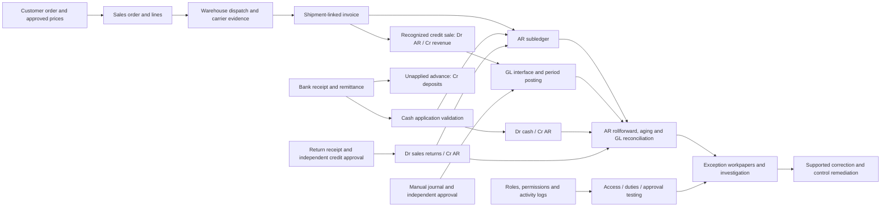

## Revenue-cycle process and evidence

Preventive controls: approved pricing, shipping support, duplicate blocks, constrained cash application, independent credit/manual journal approval and separation of billing/cash duties. Detective controls: daily interface reconciliation, month-end cutoff review, aging and access recertification. The app recommends remediation; it does not post corrections.
